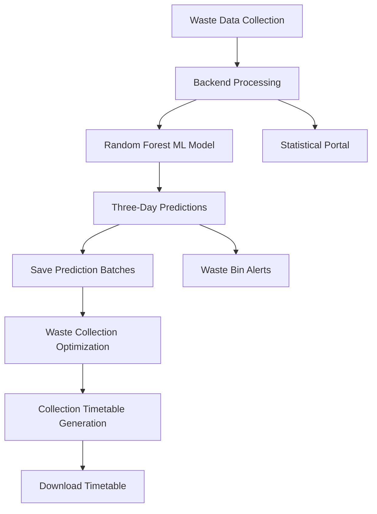

<div align="center">

# ♻️ Waste Generation Prediction & Optimization System

### Smart Waste Management Through Machine Learning and Data-Driven Optimization

A full-stack intelligent waste management platform that predicts waste bin conditions, prioritizes collection needs, and generates optimized collection timetables.

<br/>


</div>

---

## 📌 Overview

The **Waste Generation Prediction & Optimization System** is a machine learning-powered web application designed to improve waste collection planning through predictive analytics, data management, and collection optimization.

Traditional waste collection approaches often depend on reported conditions or fixed collection schedules, which may not adequately reflect changing waste accumulation patterns.

This project introduces a data-driven approach that uses a **Random Forest machine learning model** to forecast waste bin conditions over the next three days. The predictions help identify bins that may require collection soon and provide a basis for prioritizing collection activities.

The platform integrates data collection, backend processing, machine learning predictions, prediction batch management, collection optimization, timetable generation, alerts, and statistical monitoring into one system.

## 🎯 Project Objectives

- Develop a machine learning model for forecasting future waste bin conditions.
- Support proactive waste collection planning through predictive analytics.
- Prioritize waste bins based on their predicted conditions.
- Generate structured collection timetables using prediction results.
- Provide alerts for waste bins that may require collection soon.
- Improve access to waste management statistics for informed decision-making.

## ⚙️ How It Works

The system consists of eight interconnected functional components.

### 1. Data Collection
Users submit waste bin condition reports through the frontend interface. Registered Shehias are retrieved from the backend, allowing users to select the appropriate location and provide relevant waste information.

### 2. Backend Data Management
The backend receives, stores, and manages waste records. It connects the data collection interface with the machine learning model, prediction storage, optimization module, alerts, and statistical portal.

### 3. Machine Learning Prediction
A **Random Forest model** analyzes available waste data and forecasts the expected condition of each bin for the next three days.

The generated predictions are returned to the backend for storage, visualization, and further processing.

### 4. Prediction Batch Management
Generated predictions can be saved in organized batches. This allows users to retrieve and reuse existing prediction results during collection planning without unnecessarily regenerating predictions.

### 5. Waste Collection Optimization
The optimization module uses saved prediction batches to identify and prioritize bins according to their predicted waste conditions.

This helps collection teams focus on bins that are expected to require attention sooner.

### 6. Collection Timetable Generation
The Real-Time Prediction feature supports the generation of updated waste collection timetables using available predictions and optimization results.

Generated timetables can be viewed within the application and downloaded for operational planning and reporting.

### 7. Waste Bin Alerts
The alert module highlights bins reported or predicted to require attention within a short period, helping users identify potentially critical collection needs.

### 8. Statistical Portal
The statistical portal provides summaries and visual representations of recorded waste bin conditions.

It supports monitoring of waste levels, identification of patterns across registered locations, and evidence-based decision-making.

---

## 🔄 System Workflow



## 🧠 Machine Learning Approach

The project uses the **Random Forest algorithm** to predict future waste bin conditions.

| Component | Description |
|---|---|
| Algorithm | Random Forest |
| Learning Approach | Supervised Machine Learning |
| Prediction Horizon | 3 days |
| Input | Available historical and reported waste data |
| Output | Predicted waste bin conditions |
| Application | Waste collection prioritization |

The prediction results serve as inputs for collection optimization and timetable generation.

## ✨ Key Features

- 📝 Waste bin condition data collection.
- 📍 Registered Shehia management.
- 🤖 Random Forest-based waste condition forecasting.
- 📅 Three-day prediction horizon.
- 💾 Prediction batch storage and retrieval.
- 🎯 Prediction-based collection prioritization.
- 📊 Collection timetable generation and download.
- 🚨 Waste bin alerts.
- 📈 Statistical monitoring and visualization.

## 🏗️ System Architecture

The platform follows a full-stack architecture consisting of three main layers:

**Frontend Layer**
- User interaction and waste data submission.
- Prediction result presentation.
- Collection timetable and statistical visualization.

**Backend Layer**
- API communication and data management.
- Prediction batch management.
- Integration of machine learning predictions.
- Collection optimization and alerts.

**Machine Learning Layer**
- Waste data processing.
- Random Forest model execution.
- Three-day waste condition forecasting.

## 🛠️ Technology Stack

The project uses the following technologies:

<div align="center">


</div>

| Layer | Technologies |
|---|---|
| Frontend | React, JavaScript, HTML, CSS |
| Backend | Python, Django |
| Machine Learning | Scikit-learn, Random Forest |
| Data Processing | Pandas, NumPy |
| Visualization | Matplotlib |

## 🌍 Expected Impact

The system aims to contribute to smarter and more proactive waste management by:

- Improving visibility into waste bin conditions.
- Identifying potential collection needs earlier.
- Supporting better collection prioritization.
- Providing structured information for operational planning.
- Encouraging data-driven waste management decisions.

By combining machine learning predictions with collection optimization, the platform provides a foundation for more intelligent waste management practices.

## 🔮 Future Improvements

Potential areas for further development include:

- Exploring advanced machine learning algorithms to improve prediction performance.
- Integrating geospatial analysis for location-aware collection planning.
- Developing route optimization capabilities for waste collection vehicles.
- Incorporating real-time IoT-based waste monitoring.
- Expanding analytical capabilities for long-term waste generation trends.


## 🚀 Installation & Setup

Follow these instructions to download, install, and run the project on your local machine.

### 1. Prerequisites

Before installing the project, ensure that the following tools are installed:

| Software | Recommended Version | Purpose |
|---|---|---|
| Python | 3.11 | Backend development and Machine Learning |
| Node.js | LTS | Frontend development |
| npm | Included with Node.js | Frontend package management |
| Git | Latest | Repository cloning |

Verify your installations:

```bash
python --version
node --version
npm --version
git --version
```

### 2. Clone the Repository

Open your terminal or PowerShell and navigate to the directory where you want to store the project.

Clone the repository:

```bash
git clone https://github.com/Idrissafakiyahya/waste-generation-predictions-and-optimization.git
```

Navigate into the project directory:

```bash
cd waste-generation-predictions-and-optimization
```

### 3. Backend Installation (Django)

The backend handles data management, API requests, machine learning integration, prediction storage, and collection optimization.

**Step 1: Navigate to the backend directory**

```bash
cd backend
```

**Step 2: Create a Python virtual environment**

```bash
python -m venv .venv
```

**Step 3: Activate the virtual environment**

For Windows PowerShell:

```powershell
.\.venv\Scripts\Activate.ps1
```

If PowerShell blocks script execution, run:

```powershell
Set-ExecutionPolicy -Scope Process -ExecutionPolicy Bypass
.\.venv\Scripts\Activate.ps1
```

**Step 4: Upgrade pip**

```bash
python -m pip install --upgrade pip
```

**Step 5: Install backend dependencies**

```bash
pip install -r requirements.txt
```

If the project does not contain a `requirements.txt` file, install the required packages according to the project's dependencies.

**Step 6: Apply database migrations**

```bash
python manage.py migrate
```

The project uses SQLite for local database storage.

**Step 7: Create an administrator account**

```bash
python manage.py createsuperuser
```

Follow the prompts to create your administrator username, email, and password.

**Step 8: Start the Django development server**

```bash
python manage.py runserver
```

The backend should now be accessible at:

- API / Backend: http://127.0.0.1:8000
- Django Admin: http://127.0.0.1:8000/admin

Keep this terminal running while using the application.

### 4. Frontend Installation (React + Vite)

Open a second terminal window.

**Step 1: Navigate to the frontend directory**

From the project root:

```bash
cd frontend
```

**Step 2: Install frontend dependencies**

```bash
npm install
```

**Step 3: Start the development server**

```bash
npm run dev
```

The frontend should now be accessible at:

http://localhost:5173

If port 5173 is already occupied, Vite may automatically select another available port. Use the URL displayed in your terminal.

Keep the frontend terminal running while using the application.

### 5. Access the Application

Once both servers are running, open your browser and access the following addresses:

| Component | Local URL |
|---|---|
| Frontend Application | http://localhost:5173 |
| Django Backend | http://127.0.0.1:8000 |
| Admin Dashboard | http://127.0.0.1:8000/admin |

You can now interact with the application, submit waste bin reports, generate predictions, manage prediction batches, and explore the available system features.

### 6. Running the Project Again

Whenever you want to run the project again, you do not need to reinstall the dependencies.

Open two terminal windows.

**Terminal 1 – Backend**

```powershell
cd backend
.\.venv\Scripts\Activate.ps1
python manage.py runserver
```

**Terminal 2 – Frontend**

```bash
cd frontend
npm run dev
```

### 7. Troubleshooting

**Issue: Django module not found**

Install the backend dependencies inside the activated virtual environment:

```bash
pip install -r requirements.txt
```

**Issue: Database tables are missing**

Run:

```bash
python manage.py migrate
```

**Issue: Frontend cannot communicate with the backend**

- Ensure that the Django backend is running.
- Verify that the frontend API configuration points to the correct backend address.
- Check the browser console for API errors.

**Issue: Port 8000 is already in use**

Start Django on another port:

```bash
python manage.py runserver 8001
```

Ensure that the frontend API configuration uses the updated backend address.

**Issue: Frontend dependencies are missing**

Navigate to the frontend directory and run:

```bash
npm install
```

### 8. Stopping the Application

To stop either development server, press:

```text
CTRL + C
```

### ⚠️ Important Notes

- Do not upload your `.venv` or `node_modules` directories to GitHub.
- Keep environment variables and secret keys out of public repositories.
- Use development credentials only for local testing.
- Never expose administrator passwords in the README.
- For production deployment, configure appropriate security settings, environment variables, and database credentials.

---

**Installation Complete! 🎉**

You have successfully set up the Waste Generation Prediction & Optimization System for local development.


  

## 👨‍💻 Author

**Idrissa Faki Yahya**

Data Scientist | Machine Learning Engineer

Interested in Artificial Intelligence, Machine Learning, Predictive Analytics, and Data-Driven Solutions.

- GitHub: [@Idrissafakiyahya](https://github.com/Idrissafakiyahya)
- Email: idrissafakiyahya2003@gmail.com

---

<div align="center">

**♻️ Building smarter waste management systems through data and machine learning.**

</div>
